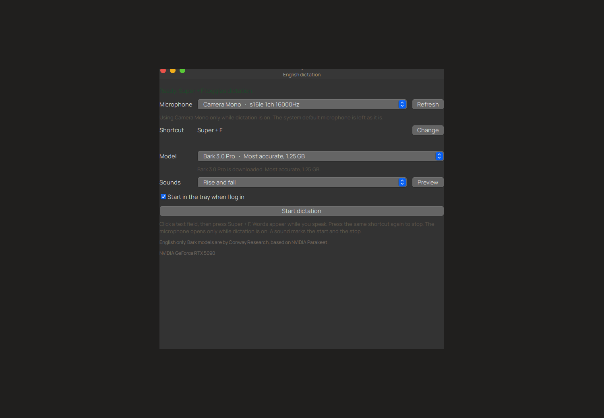
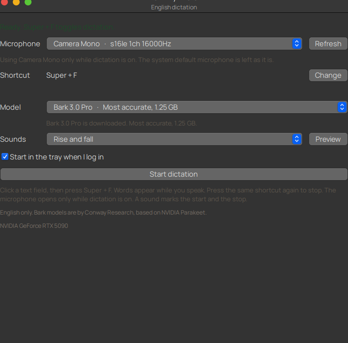

# Talk Anywhere

Toggle English dictation into the text field you are typing in. Talk Anywhere sits in the GNOME tray, opens the microphone only while dictation is on, and types the words as you speak.



The first launch asks you to pick a Bark model, a Windows-key shortcut, a microphone, and a start/stop sound.



## Dictate

1. Click a text field.
2. Press the shortcut. The default is **Ctrl + Super + Space**.
3. Speak. Text shows up while you are still talking.
4. Press the same shortcut again. The microphone closes.

A sound plays when dictation starts, and a different sound plays when it stops. In Settings, choose a pair and press Preview:

- Rise and fall
- Bright bell
- Soft pop
- Wood knock

Changing the shortcut listens for the next keys only while the settings window is focused. Leaving the window cancels that. The shortcut you already saved keeps working either way.

Closing the window leaves the app in the tray. It can also start when you log in.

## Bark models

Setup can download any of these English models. Nothing is sent off the machine when you dictate.

| Model | Download | What you get |
| --- | --- | --- |
| Bark 3.0 Pro | 1.25 GB | Full precision, the most accurate |
| Bark 3.0 Plus | 180 MB | Every word, fewer mistakes |
| Bark 3.0 | 163 MB | Every word, smallest file |
| Bark 3.0 Clean | 180 MB | Drops “um”, fillers, and false starts |

They are by [Conway Research](https://huggingface.co/ConwayResearch). Pro is CC BY-NC 4.0. The other three are CC BY 4.0. All of them are based on NVIDIA Parakeet.

## Install

This build is for GNOME on X11 with an NVIDIA GPU.

```bash
sudo apt install python3-gi gir1.2-ayatanaappindicator3-0.1 xdotool pulseaudio-utils
git clone https://github.com/EntangledQuantum/talk-anywhere.git
cd talk-anywhere
uv venv --python 3.12 .venv
uv pip install --python .venv/bin/python 'torch==2.8.0+cu128' --index-url https://download.pytorch.org/whl/cu128
uv pip install --python .venv/bin/python -e . --no-deps
uv pip install --python .venv/bin/python \
  'transformers==5.19.0' 'numpy==2.4.6' 'librosa==0.11.0' \
  'soundfile==0.14.0' 'soxr==1.1.0' 'huggingface_hub>=0.26' 'constriction>=0.5.0'
PYTHONPATH=src /usr/bin/python3 -m talk_anywhere install
talk-anywhere
```

Install the CUDA build of PyTorch first. `uv pip install -e .` on its own can replace it with a CPU build.

The Ubuntu AppIndicators extension has to be enabled, which it is on a normal Ubuntu session. The tray icon is how you open Settings, start or stop dictation, and quit.

## Contributing

Contributions are welcome. More model support is coming, and more platform support is coming, including Wayland and desktops besides GNOME.

Open an issue or a pull request if you want to add a model, a desktop, or a sound pair.
